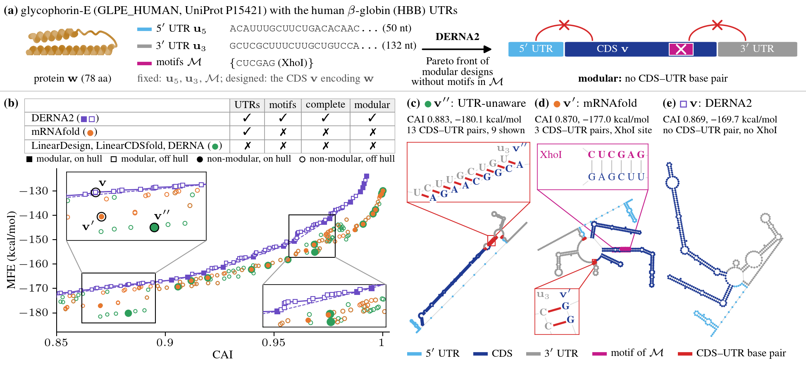
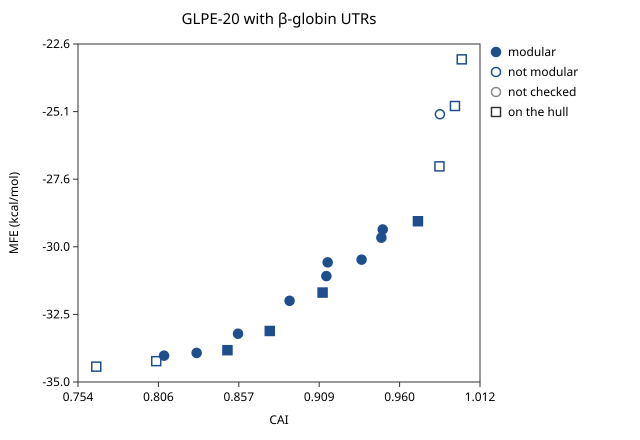

# DERNA2

**Full Pareto fronts of modular mRNA designs with UTRs.**

DERNA2 is an exact algorithm for the **UTR-Aware Pareto Optimal RNA Design**
(UTR-PORD) problem, which seeks Pareto-optimal mRNA designs with UTRs under
two objectives: minimum free energy (MFE) and the codon adaptation index
(CAI). Given a protein sequence *w*, 5′ and 3′ untranslated regions (UTRs)
*u*₅ and *u*₃, and forbidden motifs *M*, it computes the Pareto front of the
motif-free coding sequences (CDSs) *v* encoding *w* such that the mRNA
*u*₅ · *v* · *u*₃ has an MFE structure without CDS–UTR base pairs. Such a
design is called **modular**.
DERNA2 computes the complete motif-free front in polynomial time without UTRs.
The worst-case running time with UTRs is exponential, but DERNA2 can run under
a budget. A budgeted run returns a partial Pareto front.



**(a)** Here, *w* is the human glycophorin-E protein (GLPE) with the UTRs
*u*₅ and *u*₃ of human β-globin (hbb) and the XhoI restriction site
*M* = {`CUCGAG`} forbidden. **(b)** Current methods (colors) identify only
designs on the convex hull of their Pareto fronts (filled) and miss most
Pareto-optimal designs (open), namely 86% for LinearDesign, LinearCDSfold and
DERNA and 81% for mRNAfold. None of the designs on these fronts is modular
(circles), i.e., has an MFE structure without CDS–UTR base pairs. **(c)** The
design (*v*″, *P*″) (green) is computed without UTRs and forms 13 base pairs
between the CDS and *u*₃ once the UTRs are added. **(d)** While mRNAfold
directly incorporates UTRs and penalizes CDS–UTR base pairs, its design
(*v*′, *P*′) still forms 3 CDS–UTR base pairs and contains the XhoI site.
**(e)** The design (*v*, *P*) of DERNA2 has no CDS–UTR base pairs and no motif
in *M*.

## Install

1. Install Rust with [rustup](https://rustup.rs):

   ```bash
   curl --proto '=https' --tlsv1.2 -sSf https://sh.rustup.rs | sh
   ```

2. Clone and build:

   ```bash
   git clone https://github.com/elkebir-group/derna2.git
   cd derna2
   cargo build --release -p derna
   ```

   The binary is `target/release/derna`. To put it on your `PATH`, run
   `cargo install --path packages/derna`. The first build compiles the
   dependency tree with link-time optimization and could take tens of
   minutes.

3. Optionally, run the tests:

   ```bash
   cargo test --release --workspace
   ```

## The `derna` command

| Command | What it does |
|---|---|
| `derna design` | the best design at each given trade-off weight λ |
| `derna front` | the exact Pareto front of (MFE, CAI) |
| `derna check` | certify a result's points against their free folds |
| `derna pool` | join certified per-stop-codon fronts |
| `derna show` | render, filter, plot or export a result file |
| `derna pick` | choose one design and write it as FASTA |

Energies are in kcal/mol. Each result is a JSONL file that carries the inputs
as well as the output. `derna show`, `check` and `pick` can be run
independently on the results.

## Examples

All examples below use a 20-residue test protein and a pair of 25-nt UTRs, and
each finishes in seconds.

```bash
alias derna=./target/release/derna
P=packages/derna-codon-dp/tests/data/GLPE_HUMAN_20.fasta
U5=ACAUUUGCUUCUGACACAACUGUGU
U3=GCUCGCUUUCUUGCUGUCCAAUUUC
```

### Design at a fixed trade-off weight λ

`--lambda` weighs MFE against CAI, strictly between 0 and 1. At 1 only the
energy matters, and at 0 only the codon usage.

```bash
derna design --protein $P --lambda 0.5 --out design.jsonl
```

```text
[1/1] λ=0.5 mfe=-27.80 cai=0.8498 (0.07s)
1 design(s), unconstrained — no check to give

wrote design.jsonl:
design — 20 residue(s) of GLPE_HUMAN_20aa_cut
  5′ UTR absent   3′ UTR absent   stop none
  constraint none   access off
  codon usage human   derna 0.1.0   0.08s   peak 5 MB
  1 point(s), 1 on the hull, not checked

       mfe       cai     gc      gap  modular   hull    lambda  status
    -27.80    0.8498   0.52        —        —    yes  0.500000  —
```

To design at several weights in one run, give `--lambda` a list:

```bash
derna design --protein $P --lambda 0.1,0.5,0.9 --out designs.jsonl
```

```text
[1/3] λ=0.1 mfe=-21.50 cai=0.9857 (0.06s)
[2/3] λ=0.5 mfe=-27.80 cai=0.8498 (0.06s)
[3/3] λ=0.9 mfe=-30.00 cai=0.6605 (0.06s)
3 design(s), unconstrained — no check to give
```

### Design several proteins in one run

`--protein` can also take a FASTA with several records. `--out` then should
name a directory, and each record is written to `<id>.jsonl` inside it.

```bash
cat > two.fasta <<'EOF'
>GLPE20
MYGKIIFVLLLSGIVSISAS
>HBB20
MVHLTPEEKSAVTALWGKVN
EOF

derna design --protein two.fasta --lambda 0.5 --out batch/
```

```text
...
wrote batch/HBB20.jsonl:
design — 20 residue(s) of HBB20
  5′ UTR absent   3′ UTR absent   stop none
  constraint none   access off
  codon usage human   derna 0.1.0   0.03s   peak 5 MB
  1 point(s), 1 on the hull, not checked

       mfe       cai     gc      gap  modular   hull    lambda  status
    -44.10    0.7923   0.57        —        —    yes  0.500000  —

batch of 2 record(s): GLPE20 ok; HBB20 ok
```

A protein that fails is reported and the batch carries on, with a non-zero
exit at the end. If a run is interrupted, rerun it with `--checkpoint` to skip
the proteins already finished.

### Compute the Pareto front without UTRs

To compute the front without UTRs, give `front` the protein and nothing
else.

```bash
derna front --protein $P --out plain.jsonl
```

```text
18 point(s), 9 on the hull, 8 gap(s), 10 sweep fold(s) (1.63s), spanning 12.4 kcal/mol

wrote plain.jsonl:
front — 20 residue(s) of GLPE_HUMAN_20aa_cut
  5′ UTR absent   3′ UTR absent   stop none
  constraint none   access off
  codon usage human   derna 0.1.0   1.63s   peak 9 MB
  18 point(s), 9 on the hull, not checked

       mfe       cai     gc      gap  modular   hull    lambda  status
    -30.00    0.6605   0.53        —        —    yes         —  —
    -29.20    0.7303   0.53        —        —    yes         —  —
       ...
    -19.30    0.9957   0.58        —        —    yes         —  —
    -17.60    1.0000   0.58        —        —    yes         —  —
```

### Compute the Pareto front with UTRs

Add `--utr5` and `--utr3`. The coding sequence is then forbidden from pairing
with either UTR, and each design is checked against its own free fold. The
`gap` column is what that constraint costs the design, in kcal/mol, and a
design with a gap of 0 is **modular**.

```bash
derna front --protein $P --utr5 $U5 --utr3 $U3 --out front.jsonl
```

```text
19 point(s), 9 on the hull, 8 gap(s), 11 sweep fold(s) (2.39s), spanning 11.2 kcal/mol
13 of 19 point(s) modular

wrote front.jsonl:
front — 20 residue(s) of GLPE_HUMAN_20aa_cut
  5′ UTR 25 nt   3′ UTR 25 nt   stop free
  constraint 5-cds,cds-3   access off
  codon usage human   derna 0.1.0   2.39s   peak 14 MB
  19 point(s), 9 on the hull, 13 of 19 modular

       mfe       cai     gc      gap  modular   hull    lambda  status
    -34.40    0.7657   0.49     0.70       no    yes         —  —
    -34.20    0.8041   0.49     0.70       no    yes         —  —
    -34.00    0.8092   0.47     0.00      yes     no         —  certified
    -33.90    0.8301   0.47     0.00      yes     no         —  certified
    -33.80    0.8498   0.47     0.00      yes    yes         —  certified
       ...
    -29.10    0.9719   0.49     0.00      yes    yes         —  certified
    -27.10    0.9857   0.50     2.50       no    yes         —  —
    -25.20    0.9860   0.50     6.10       no     no         —  —
    -24.90    0.9957   0.51     4.90       no    yes         —  —
    -23.20    1.0000   0.51    11.10       no    yes         —  —
```

Omitting `--stop` leaves the stop codon to the search (`stop free` above),
while `--stop UAA` fixes it and `--stop none` asks for none.

### Compute the modular front

`--modular` walks the front of designs that are modular by construction,
rather than checking for modularity afterwards. It is the expensive mode, so it takes a budget.
Here it hits the 60-second limit with one region of the front still open.

```bash
derna front --protein $P --utr5 $U5 --utr3 $U3 --modular --max-secs 60 --out modular.jsonl
```

```text
walking the front of 20 residue(s) over [1.1920928955078125e-7, 1 − 1.1920928955078125e-7], forbidding 5-cds,cds-3, on a grid of 17 weights with 1 thread(s)
19 point(s), 9 on the hull, 8 gap(s), 11 sweep fold(s) (2.13s), spanning 11.2 kcal/mol
walking the modular front from 19 constrained point(s) within 60 s
16 point(s) on the modular front, 16 certified, from 13 seed(s); stopped by the time budget with 1 region(s) open (63.37s)
wrote 16 point(s), by gap 0.00×16 (0.05s)
```

Add `--threads N` to parallelize it, and `--checkpoint`/`--resume` to continue
a walk that ran out of budget.

### Compute the motif-free front

`--motif` forbids a subsequence anywhere in the coding sequence. Repeat it or
pass a file of patterns, and scope one with `--motif-window`.

```bash
derna front --protein $P --utr5 $U5 --utr3 $U3 --motif GCGGC --out motif.jsonl
```

```text
walking the front of 20 residue(s) avoiding GCGGC over the coding sequence, forbidding 5-cds,cds-3, with 1 thread(s)
24 point(s), 8 on the hull, 7 gap(s), 3 hull fold(s) (2.63s)
11 of 24 point(s) modular
```

### Filter a saved result

`show` re-renders a result file and filters it, without folding anything.

```bash
derna show front.jsonl --modular --fasta | head -4
```

```text
>GLPE_HUMAN_20aa_cut point=3 mfe=-34.00 cai=0.8092 gc=0.47
ACAUUUGCUUCUGACACAACUGUGUAUGUAUGGCAAGAUCAUCUUUGUCCUGCUGCUGAGCGGGAUAGUGUCGAUCUCUGCCAGCUAAGCUCGCUUUCUUGCUGUCCAAUUUC
>GLPE_HUMAN_20aa_cut point=4 mfe=-33.90 cai=0.8301 gc=0.47
ACAUUUGCUUCUGACACAACUGUGUAUGUAUGGCAAGAUCAUCUUUGUGCUGCUGCUGAGCGGCAUAGUGUCGAUCUCUGCCAGUUAGGCUCGCUUUCUUGCUGUCCAAUUUC
```

`--min-gc`, `--max-gc` and `--max-homopolymer` filter on sequence metrics, and
`--sequences` adds the per-point GC, U and homopolymer columns.

### Plot a front

`--plot` writes an SVG with CAI on the x axis and MFE on the y axis, marking
hull points and distinguishing modular from non-modular ones. It is titled
with the record's name, or with `--plot-title` instead.

```bash
derna show front.jsonl --plot front.svg --plot-title "GLPE-20 with β-globin UTRs"
```



### Pick one design from the front

`pick` applies selection rules to a result file and writes one design. `--dna` spells T
for U and `--cds-only` drops the UTRs.

```bash
derna pick front.jsonl --best-cai --modular
```

```text
>GLPE_HUMAN_20aa_cut point=15 mfe=-29.10 cai=0.9719 gc=0.49
ACAUUUGCUUCUGACACAACUGUGUAUGUAUGGCAAGAUCAUCUUCGUGCUGCUGCUGAGCGGCAUCGUGAGCAUCUCUGCCAGCUAAGCUCGCUUUCUUGCUGUCCAAUUUC
```

```bash
derna pick front.jsonl --best-mfe --min-cai 0.9 --cds-only --dna
```

```text
>GLPE_HUMAN_20aa_cut point=9 mfe=-31.70 cai=0.9108 gc=0.47
ATGTATGGCAAGATCATCTTTGTGCTGCTGCTGAGCGGCATAGTGAGCATCTCTGCCAGCTAA
```

`--knee` takes the point farthest from the chord joining the front's two ends,
and `--json` writes the point's JSONL row instead of FASTA. A rule that selects
nothing exits non-zero and names the filter that emptied the set.

### Certify a result for modularity

`front` certifies its own points, so `check` is for results produced with
`--no-check`, and for `design` output.

```bash
derna front --protein $P --utr5 $U5 --utr3 $U3 --no-check --out raw.jsonl
derna check raw.jsonl --out checked.jsonl
```

```text
13 of 19 point(s) modular

wrote checked.jsonl:
check — 20 residue(s) of GLPE_HUMAN_20aa_cut
  5′ UTR 25 nt   3′ UTR 25 nt   stop free
  constraint 5-cds,cds-3   access off
  codon usage human   derna 0.1.0   0.09s   peak 3 MB
  19 point(s), 9 on the hull, 13 of 19 modular
```

`check` saves progress as it goes and resumes where it stopped, since folding a
large front can take hours.

Every command lists the flags it takes under `--help`, for example
`derna front --help`. The full reference for every command and flag, what each
one reports and what a run costs is in
[docs/guides/derna-cli.md](docs/guides/derna-cli.md).

## Repository layout

| Package | What it is |
|---|---|
| `packages/rna-mfe` | Turner 2004 energy evaluation and Zuker MFE folding (dangles = 0) |
| `packages/derna-codon-dp` | Codon-design dynamic programs over the codon lattice |
| `packages/derna-lib` | The exact front, region and motif constraints, and certification |
| `packages/derna` | The `derna` command-line tool |

## Acknowledgements

We used Claude (Anthropic) to support code development. The authors reviewed
and tested all AI-assisted code and analyses, and take full responsibility for
the content.

## Third-party data

- **Energy parameters.** The default parameters,
  `packages/rna-mfe/data/turner2004.params`, are the Turner 2004
  nearest-neighbor parameters from [NNDB](https://rna.urmc.rochester.edu/NNDB/),
  the Nearest Neighbor Database. Please cite Mittal, Turner & Mathews (2024),
  *J. Mol. Biol.* 168549,
  [doi:10.1016/j.jmb.2024.168549](https://doi.org/10.1016/j.jmb.2024.168549);
  Turner & Mathews (2010), *Nucleic Acids Res.* 38, D280–D282; and
  Mathews et al. (2004), *Proc. Natl. Acad. Sci. USA* 101, 7287–7292.
- **Codon usage.** The human codon usage table,
  `packages/derna-codon-dp/data/codon_usage_human.csv`, is from the
  [Codon Usage Database](https://www.kazusa.or.jp/codon/) at the Kazusa DNA
  Research Institute (Nakamura, Gojobori & Ikemura (2000), *Nucleic Acids Res.*
  28, 292).
- **Protein sequences.** The test data hold UniProtKB entries
  [P15421](https://www.uniprot.org/uniprotkb/P15421) (glycophorin-E) and
  [P0DTC2](https://www.uniprot.org/uniprotkb/P0DTC2) (SARS-CoV-2 spike
  glycoprotein), some cut to their first residues, from
  [UniProt](https://www.uniprot.org/) under
  [CC BY 4.0](https://creativecommons.org/licenses/by/4.0/).

[NOTICE](NOTICE) gives the full citations.

## Citation

See [CITATION.cff](CITATION.cff).

## Authors

Xinyu Gu, Mark D. M. Leiserson and Mohammed El-Kebir.
